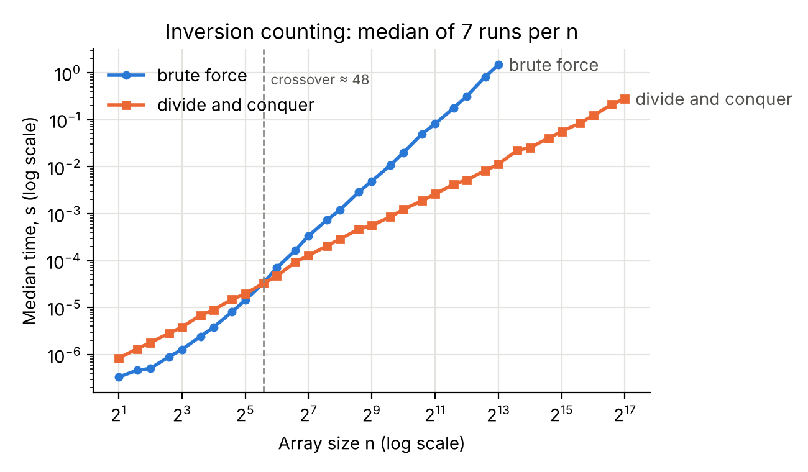
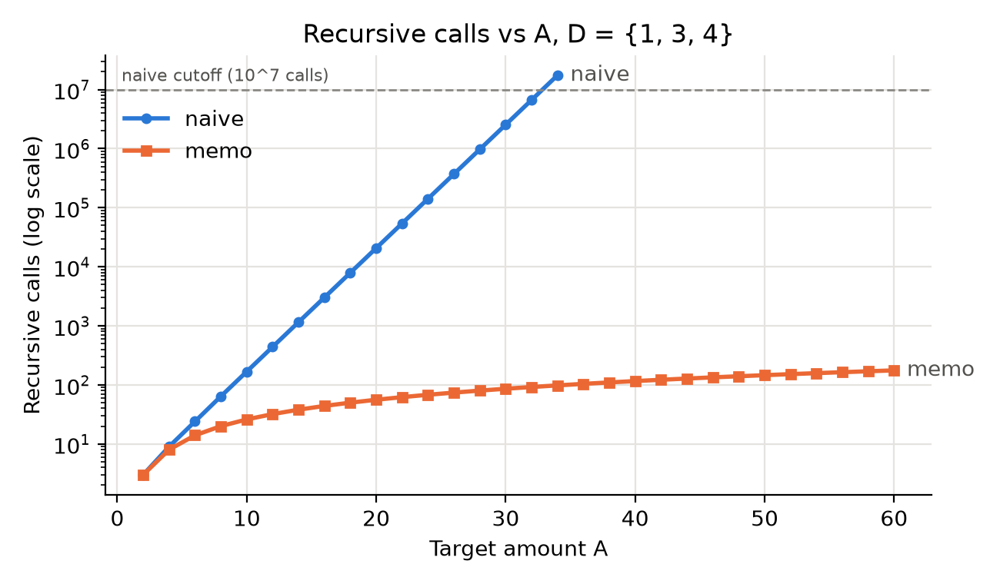
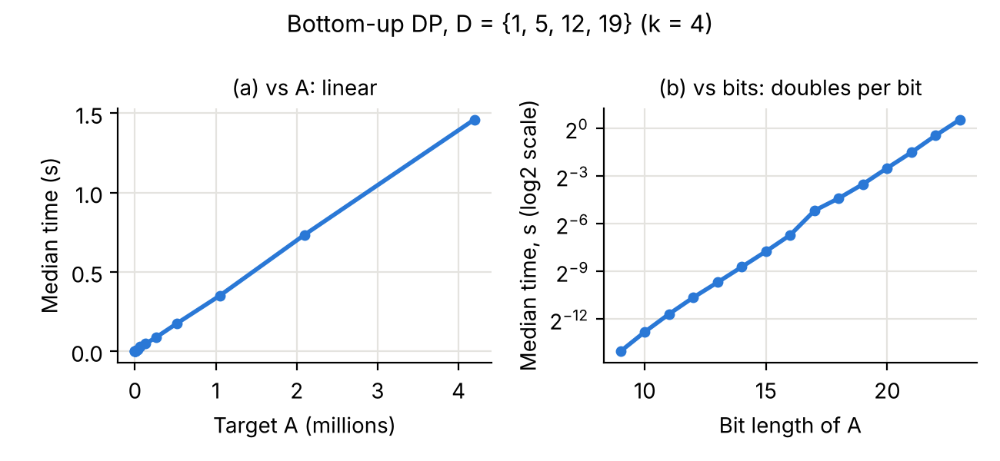

# From Brute Force to Better Algorithms: Divide and Conquer + Dynamic Programming

**CMP_SC 4050: Group Algorithm Engineering Assignment 2** · Fall 2026
**Team:** Solomon Canoy, Ryly Dou, Prajit, Micky Sheridan · **Submitted:** November 12, 2026

## 1. Introduction

This report follows one idea twice: start from a correct but slow baseline, then build a faster
algorithm that gives the same answers. In Part I, divide and conquer takes inversion counting from
Θ(n²) to Θ(n log n) by counting cross inversions in bulk during the merge. In Part II, dynamic
programming removes the repeated work of naive recursion in coin change, and we search for cases
where the greedy heuristic fails. For each part we implemented the algorithms, checked the fast
versions against the slow ones on hand-checked and seeded random inputs, measured how they scale,
and explained the results. The code is Python 3.10+ with matplotlib and pytest. The README lists
the machine, Python version, and exact commands behind every table and figure.

---

## 2. Part I: Counting Inversions

### 2.1 Algorithms

An inversion in an array $A$ is a pair of indices $(i, j)$ such that $i < j$ and $A[i] > A[j]$, representing two elements that appear out of sorted order.

The brute-force algorithm (`brute_force`) checks every pair $(i, j)$ with $0 \le i < j < n$ using nested loops. For each pair, it increments a counter whenever $A[i] > A[j]$. It is simple and serves as an oracle for verification.

The divide-and-conquer algorithm (`sort_and_count`) modifies mergesort. It recursively splits the array into two halves, recursively counts inversions within each half, and merges the two sorted halves while counting cross-inversions (`merge_and_count`).

The key step occurs during the merge. Because both left and right subarrays are already sorted, when the current right element $R[j]$ is strictly smaller than the current left element $L[i]$, $R[j]$ is also smaller than every remaining element in $L$. We therefore add $|L| - i$ to the inversion count in $O(1)$ time and advance $j$.

### 2.2 Correctness

Every inversion $(i, j)$ in an array split into left half $L = A[:mid]$ and right half $R = A[mid:]$ falls into exactly one of three disjoint cases: both indices in $L$, both in $R$, or split across halves ($i < mid \le j$, a cross inversion).

We prove correctness by induction on length $n$.

**Base Case:** If $n \le 1$, no pairs exist. The algorithm returns $0$ and the array, which is correctly sorted.

**Inductive Step:** Assume `sort_and_count` correctly sorts and counts inversions for arrays of length $< n$. By hypothesis, recursive calls on $L$ and $R$ return sorted subarrays and correct counts for left and right inversions.

Sorting $L$ and $R$ permutes elements only within each half; every element of $L$ still precedes every element of $R$. Therefore, sorting preserves the exact set of cross inversions. During `merge_and_count`, elements are processed in sorted order using two pointers. When $R[j] < L[i]$, sorted order guarantees $R[j] < L[k]$ for all remaining $k \in [i, |L|-1]$. Adding $|L| - i$ accounts for all cross inversions involving $R[j]$. Because every element in $R$ is advanced exactly once, each cross inversion is counted exactly once. Combining left, right, and cross counts yields the exact total.

### 2.3 Complexity

For `brute_force`, the outer loop runs $n$ times and the inner loop runs $n - 1 - i$ times. The total number of comparisons is:
$$\sum_{i=0}^{n-1} (n - 1 - i) = \frac{n(n - 1)}{2} = \Theta(n^2)$$
Each comparison takes $O(1)$ time and requires $O(1)$ auxiliary space.

For `sort_and_count`, splitting takes $O(1)$ time, two recursive calls operate on subarrays of size $n/2$, and `merge_and_count` scans each element of $L$ and $R$ once, taking $\Theta(n)$ time. The recurrence is:
$$T(n) = 2T(n/2) + \Theta(n)$$
By Case 2 of the Master Theorem ($a = 2, b = 2, f(n) = \Theta(n)$, where $\log_b a = 1$), the recurrence solves to $\Theta(n \log n)$. A recursion tree yields the same result: $\log_2 n$ levels, each performing $\Theta(n)$ total merge work.

Merging constructs a new combined list, using $\Theta(n)$ auxiliary space at each level, alongside $O(\log n)$ call stack frames.

### 2.4 Validation

We validated `sort_and_count` against `brute_force`, treating the brute-force implementation as our oracle.

First, we tested 12 hand-checked arrays in `test_inversions.py` (Table 1), covering edge cases (empty and single-element lists), sorted arrays, reverse-sorted arrays, nearly-sorted arrays, cross-only inversions, and lists with negative numbers. Both algorithms produced matching inversion counts on every case.

Second, we performed an automated cross-check on 200 pseudo-random arrays of varying lengths ($n \in [0, 60]$) using `random.Random(4050)` (seed `SEED = 4050`). In every trial, `sort_and_count` matched the brute-force count exactly and returned an accurately sorted list.

While these 212 passing tests confirm implementation agreement across varied inputs, empirical testing does not replace mathematical proof; correctness is guaranteed by the inductive argument in Section 2.2.

**Table 1.** Hand-checked arrays (from `src/test_inversions.py`).

| Array | Type | Expected inversions | Brute force | Divide and conquer |
|---|---|---|---|---|
| `[]` | empty | 0 | 0 | 0 |
| `[42]` | single | 0 | 0 | 0 |
| `[1, 2]` | two sorted | 0 | 0 | 0 |
| `[2, 1]` | two reversed | 1 | 1 | 1 |
| `[1, 2, 3, 4, 5]` | sorted | 0 | 0 | 0 |
| `[5, 4, 3, 2, 1]` | reverse sorted | 10 | 10 | 10 |
| `[1, 2, 4, 3, 5]` | nearly sorted | 1 | 1 | 1 |
| `[2, 4, 1, 3, 5]` | random | 3 | 3 | 3 |
| `[3, 1, 4, 5, 2]` | random | 4 | 4 | 4 |
| `[6, 5, 4, 3, 2, 1]` | reverse sorted (n=6) | 15 | 15 | 15 |
| `[1, 3, 5, 2, 4, 6]` | cross-only | 3 | 3 | 3 |
| `[10, -5, 0, 7, 3]` | negative / mixed | 5 | 5 | 5 |

### 2.5 Runtime Scaling

**Method.** For each size n we built one seeded random array (seed 4050) before timing, then
timed both counters on it, so only the calls are measured. Sizes were the powers of two from 2 to
131,072 plus the midpoints 3·2^i (33 sizes) for finer steps near the crossover. Each point is the
median of 7 calls (`time_median`). Brute force stopped
after the first size whose median passed 1 s (n = 8,192, at 1.48 s). Divide and conquer continued
to n = 131,072. Machine: Intel Xeon @ 2.10 GHz cloud container (4 vCPUs, Linux), Python 3.13.18.

**Results.** On log-log axes (Figure 1) both curves become straight lines. A least-squares fit
over n ≥ 256 gives a slope of 2.04 for brute force, which matches n², and 1.11 for divide and
conquer, which matches n log n (the log factor makes it a bit more than 1). At n = 8,192, brute
force took 1.48 s and divide and conquer took 11.3 ms, about 131× faster.

**Crossover.** Brute force wins on small arrays: 0.33 µs vs 0.84 µs at n = 2, and 14.4 µs vs
19.7 µs at n = 32. The two are tied at n = 48 (34.1 vs 33.2 µs), and divide and conquer is faster
at every tested size from 48 up. Constant factors set this point, not Big-O. Our mergesort makes
about 2n recursive Python calls, copies each half with slicing, and builds new merged lists, while
brute force runs a tight compare-and-add loop. A compiled language, another Python version, or a
different CPU and cache would change these constants and move the crossover.

**Figure 1.** Median of 7 runs per n, one seeded random array per size, n = 2 to 131,072. Brute
force stopped after it passed 1 s at n = 8,192. The dashed line marks the crossover (n ≈ 48).
Intel Xeon @ 2.10 GHz, Python 3.13.18. Data: `results/benchmark_inversions.csv`.

---

## 3. Part II: Coin Change

### 3.1 Solvers

**Greedy** sorts D from largest to smallest and takes as many copies of each coin as fit. It is
fast but only a heuristic. On D = {1, 3, 4}, A = 6 it returns 4+1+1 instead of 3+3. On D = {3, 5},
A = 9 it takes 5+3, gets stuck with 1 left, and returns IMPOSSIBLE, even though 3+3+3 works.

**Naive recursion** uses best(0) = 0 and best(a) = 1 + min over coins d ≤ a of best(a − d). Any
optimal answer for a has some last coin d, and the other coins must be an optimal answer for a − d,
so trying every d finds the optimum. If no coin fits, or every sub-amount is impossible, a is
IMPOSSIBLE. Each call returns its coin list with the count. Nothing is cached, so the same amounts
are solved again and again.

**Top-down memo** runs the same recursion, but the first time it solves an amount it stores the
best count and the last coin used in a dictionary. Later calls for that amount return the stored
value. To rebuild one optimal coin list, it starts at A, takes the stored coin d, moves to A − d,
and repeats until it reaches 0.

**Bottom-up DP** fills a table best[0..A] with the same recurrence, in increasing order from
best[0] = 0. Every a − d is smaller than a, so each sub-answer is final before it's needed.
Unreachable amounts hold ∞, which never wins the min. It also stores choice[a], the coin that gave
the minimum. To rebuild one optimal coin list, it follows choice[] from A down to 0. No recursion
is needed.

### 3.2 Complexity

Let k = |D|, A be the target, and d_min the smallest coin. **Greedy** sorts in O(k log k), then
makes one pass over the coins. Writing out the coin list adds O(A/d_min). **Naive** branches up to
k ways per call, and the recursion is up to A/d_min deep, so it makes O(k^(A/d_min)) calls. On
D = {1, 3, 4} the call count grew about 2.6× for every +2 in A (Section 3.5). Each stack frame can
hold a coin list of up to A coins, so the extra space is O(A²) in the worst case. **Memo** solves
at most A + 1 distinct amounts, and each one loops over k coins once, so it takes O(kA) time. The
cache and the stack are both O(A). The depth can reach A, so memo raises Python's recursion limit.

**Bottom-up** fills all A + 1 amounts (Section 3.6 counted exactly A + 1) and checks k coins at
each: Θ(kA) time. The best and choice tables use Θ(A) space.

**Table 2.** Time and auxiliary-space complexity.

| Solver | Time | Auxiliary space | Notes |
|---|---|---|---|
| Greedy | O(k log k + A/d_min) | O(k) | Sorted copy of D. Not always optimal |
| Naive recursion | O(k^(A/d_min)) calls (exponential) | O(A²) worst case | Depth up to A/d_min; each frame holds a coin list |
| Top-down memo | O(kA) | O(A) | Cache of A + 1 entries; depth up to A/d_min |
| Bottom-up DP | Θ(kA) | Θ(A) | Two tables of A + 1 entries; fills every amount, even unreachable ones; no recursion |

### 3.3 Exact-Solver Validation

Before using bottom-up DP to judge greedy, we checked the three exact solvers against each other
(`src/test_validate.py`).

**Hand cases.** `coin_cases.py` has 12 cases with answers worked out by hand (Table 3): target 0,
three IMPOSSIBLE cases, two with more than one optimal answer, three where greedy is wrong or
stuck, and one with D out of order. A breadth-first search (`reference_count`), written separately
from every solver, gives the same 12 answers.

**Random cases.** 100 seeded instances (seed 4050), with 1–4 coins up to 10 and A from 0 to 20.
20 have no 1-coin, and 3 are IMPOSSIBLE.

**Outcome.** Naive, memo, and bottom-up returned the expected count on all 12 hand cases and
agreed on all 100 random instances. `is_valid` checked every returned answer on its own: the count
equals the list length, the coins sum to A, and every coin is in D. All passed. This shows
agreement on the inputs we tried; the general claim rests on the recurrence argument in Section 3.1.

**Table 3.** Hand-checked coin cases (from `src/coin_cases.py`).

| D | A | Expected | Naive | Memo | Bottom-up | Why it's included |
|---|---|---|---|---|---|---|
| {1, 2, 5} | 0 | 0 | 0 | 0 | 0 | target 0 |
| {1, 5, 10, 25} | 30 | 2 | 2 | 2 | 2 | US coins: 25+5 |
| {1, 2, 5} | 11 | 3 | 3 | 3 | 3 | 5+5+1 |
| {5, 1, 2} | 11 | 3 | 3 | 3 | 3 | D not sorted |
| {2} | 3 | IMPOSSIBLE | IMPOSSIBLE | IMPOSSIBLE | IMPOSSIBLE | odd A, only 2s |
| {5, 10} | 3 | IMPOSSIBLE | IMPOSSIBLE | IMPOSSIBLE | IMPOSSIBLE | A below every coin |
| {4, 7} | 17 | IMPOSSIBLE | IMPOSSIBLE | IMPOSSIBLE | IMPOSSIBLE | 17, 10, 3 not multiples of 4 |
| {1, 2, 3} | 4 | 2 | 2 | 2 | 2 | two optima: 1+3, 2+2 |
| {2, 3, 4} | 6 | 2 | 2 | 2 | 2 | two optima: 2+4, 3+3 |
| {1, 3, 4} | 6 | 2 | 2 | 2 | 2 | greedy 4+1+1; best 3+3 |
| {1, 7, 10} | 14 | 2 | 2 | 2 | 2 | greedy 10+1+1+1+1; best 7+7 |
| {3, 5} | 9 | 3 | 3 | 3 | 3 | greedy stuck; best 3+3+3 |

### 3.4 Greedy Counterexamples

**Search.** `counterexamples.py` compares greedy with bottom-up DP on every A from 0 to 50 for 32
coin systems: {1, 3, 4}, US coins {1, 5, 10, 25} as a control, and 30 distinct seeded random
systems (seed 4050), each with a 1-coin plus 2 or 3 coins up to 20. A case counts when greedy
returns a valid answer with more coins than the optimum. Cases where greedy gets stuck
(Section 3.1) are skipped, and both answers must pass `is_valid`.

**Results.** Of the 1,632 cases, 322 were counterexamples, in 25 of the 32 systems. They include
the required D = {1, 3, 4}, A = 6. US coins had none. Table 4 shows the smallest for four systems.
The largest gap was D = {1, 16, 17, 18}, A = 33: greedy used 16 coins (18 and fifteen 1s), the
optimum 2 (17+16).

**Why greedy fails.** For D = {1, 3, 4}, A = 6, greedy takes 4 because it is the largest coin that
fits. That leaves 2, which only 1+1 can make, so greedy uses 3 coins, while 3+3 uses 2. Greedy
judges each coin only by what it removes now and never undoes a choice, so it can't see that a
smaller first coin leaves a remainder the other coins fill exactly. Every row of Table 4 has this
shape: the largest coin leaves a small remainder that only 1-coins can fill.

**Table 4.** Greedy counterexamples, the smallest A for each system (from `results/counterexamples.csv`).

| D | A | Greedy coins (count) | Optimal coins (count) |
|---|---|---|---|
| {1, 3, 4} | 6 | 4+1+1 (3) | 3+3 (2) |
| {1, 6, 10} | 12 | 10+1+1 (3) | 6+6 (2) |
| {1, 5, 11} | 15 | 11+1+1+1+1 (5) | 5+5+5 (3) |
| {1, 7, 16, 19} | 23 | 19+1+1+1+1 (5) | 16+7 (2) |

### 3.5 Experiment 1: Repeated Subproblems

**Setup.** We used D = {1, 3, 4} (k = 3). It includes 1, so every A can be reached, and A ran
over 0, 2, …, 60. For each A, we ran each solver once with counters on, then timed it separately
(median of 3 runs, counters off). For safety, we stopped running naive after the first run that
passed 10^7 calls.

**Results.** Naive passed the cutoff at A = 34. It made 17,480,760 calls but reached only 35
distinct amounts, so on average it solved each amount about 500,000 times. Its call count grew about
2.6× for every +2 in A (Figure 2). At the same A, memo made 98 calls: 35 distinct states plus 63
cache hits. In every run, memo made exactly 3A − 4 calls for A ≥ 4 and solved A + 1 distinct
states, so its work grows linearly. At A = 34, naive took 1.70 s and memo took 9.7 µs.

**Interpretation.** Both solvers use the same recurrence and reach the same amounts. Naive solves
an amount again every time a different sequence of coins leads to it, and the number of such
sequences grows exponentially with A. Memo solves each amount once, and every later visit is an O(1)
cache hit. These overlapping subproblems are what dynamic programming takes advantage of.

**Figure 2.** Recursive calls vs A for D = {1, 3, 4} (log y, one counted run per point). Naive
stopped after it passed the 10^7-call cutoff at A = 34. Data: `results/exp1_repeated_subproblems.csv`.

**Table 5.** Representative rows from Experiment 1 (D = {1, 3, 4}).

| A | Naive calls | Memo calls | Distinct states | Memo cache hits |
|---|---|---|---|---|
| 10 | 168 | 26 | 11 | 15 |
| 20 | 20,736 | 56 | 21 | 35 |
| 30 | 2,550,408 | 86 | 31 | 55 |
| 34 | 17,480,760 | 98 | 35 | 63 |
| 60 | not run (cutoff) | 176 | 61 | 115 |

### 3.6 Experiment 2: Pseudo-Polynomial Scaling

**Setup.** We fixed D = {1, 5, 12, 19} (k = 4). It includes 1, so every amount is reachable and
the whole table is used. Greedy fails on it (A = 15: greedy 12+1+1+1, best 5+5+5). We doubled A from 2^8 to 2^22 (15 steps). For each A we ran `bottom_up` once with
counters on to get the states processed, then timed it separately (median of 7 runs, counters
off). Same machine as Section 2.5.

**Results.** States processed was exactly A + 1 every time, so each doubling of A doubles the
work. Each doubling multiplied the runtime by 1.7× to 2.9× (median 2.0×), and time per state
stayed between 235 and 423 ns. So time is a straight line against A (Figure 3a), and also against
bit length on a log axis (Figure 3b): each extra bit doubles the time.

**Interpretation.** The input size of a number is the bits needed to write it, b = ⌊log2 A⌋ + 1,
not its value. So O(kA) = O(k · 2^b). That's linear in the value of A but exponential in the
input length, which is what pseudo-polynomial means. Here, going from 9 bits to 23 bits (an
input only 14 bits longer) multiplied the runtime by about 24,000×.

**Figure 3.** Bottom-up DP on D = {1, 5, 12, 19}, A = 2^8 to 2^22, median of 7 runs. (a) Time vs
A is linear. (b) Time vs bit length on a log2 axis is a straight line, so time doubles with each
extra bit. Data: `results/exp2_pseudo_polynomial.csv`.

**Table 6.** Pseudo-polynomial scaling (selected rows; all 15 are in the CSV).

| A | Bit length | States processed | Median time (s) | Time per state (ns) |
|---|---|---|---|---|
| 256 | 9 | 257 | 0.0000605 | 235 |
| 4,096 | 13 | 4,097 | 0.00122 | 297 |
| 65,536 | 17 | 65,537 | 0.0277 | 423 |
| 1,048,576 | 21 | 1,048,577 | 0.350 | 334 |
| 2,097,152 | 22 | 2,097,153 | 0.734 | 350 |
| 4,194,304 | 23 | 4,194,305 | 1.46 | 348 |

---

## 4. Cross-Paradigm Reflection

**Q1. What work does divide and conquer avoid compared with checking every pair?**
Brute force redundantly checks all $\binom{n}{2} = \Theta(n^2)$ pairs one by one. Divide and conquer avoids this pairwise search during the merge step by exploiting the sorted order of each half. When a right-half element $R[j]$ is smaller than a left-half element $L[i]$, it is guaranteed to be smaller than all remaining elements $L[i \dots |L|-1]$. Instead of doing $|L| - i$ separate comparisons, the algorithm counts all $|L| - i$ inversions in a single $O(1)$ arithmetic addition.

**Q2. Why are inversion subproblems independent before the merge, while coin-change subproblems overlap heavily?**
Inversion subproblems are disjoint slices of the array: the two halves share no elements, so no
subarray is solved twice and the recursion makes only about 2n calls. Coin-change subproblems are
amounts, and many coin orders reach the same amount: with D = {1, 3, 4}, taking 4, or 3 then 1,
or 1 then 3 all reach A − 4. At A = 34, naive recursion made 17,480,760 calls on only 35 distinct
amounts (Section 3.5). Bottom-up solves each amount once.

**Q3. What role does sorting play in the divide-and-conquer improvement?**
Sorting is the mechanism that enables batch counting of cross inversions. By maintaining the invariant that recursive calls return sorted subarrays, the merge step can infer relative order across multiple pairs by transitivity. If the halves were unsorted, seeing $L[i] > R[j]$ would tell us nothing about whether subsequent left elements exceed $R[j]$, forcing an exhaustive pairwise check of $\Theta(n^2)$. Sorting costs only $\Theta(n \log n)$ overall while reducing merge comparisons from quadratic to linear $\Theta(n)$.

**Q4. Naive and memoized coin change use essentially the same recurrence. Why can their runtimes be so different?**
Memo doesn't change the recurrence. It only skips repeated work. At A = 34, both solvers reached the
same 35 amounts, but naive made 17,480,760 calls while memo made 98 (35 solves plus 63 cache hits).
Naive's work follows the number of paths through the recursion tree, which grows exponentially in A.
Memo's work follows the number of distinct states times k, which is O(kA). That gap is why naive
took 1.70 s and memo took 9.7 µs (Section 3.5).

**Q5. How did the baseline and exact implementations help validate the faster algorithms in both halves?**
In both halves the slow version is simple enough to check by reading it, so it served as the
answer key. Brute force checked `sort_and_count` on 12 hand arrays and 200 random ones
(Section 2.4). Naive recursion copies the coin recurrence directly, and it agreed with memo and
bottom-up on 12 hand cases and 100 random instances (Section 3.3), with a separate BFS answer key
and `is_valid` as extra checks. Only then did we trust bottom-up to judge greedy (Section 3.4).

**Q6. For a new optimization problem, what evidence would make you try divide and conquer first? What would make you try dynamic programming?**
Try divide and conquer first when the input splits into disjoint parts that can be solved on their
own, and the real work is a cheap combine step that can use structure from the parts, like the
sorted halves in the merge. Try dynamic programming when a natural recursion keeps reaching the
same subproblems, indexed by a small set of values: at A = 34, naive recursion made 17,480,760
calls but reached only 35 distinct amounts (Section 3.5). Check how big that set is first. Coin
change has A + 1 states, so O(kA) is only pseudo-polynomial and doubles with every extra bit of A
(Section 3.6).

---

## Contribution Statement

_Separate deliverable; doesn't count toward the page limit._

| Member | Role | Primary contributions |
|---|---|---|
| Solomon Canoy | P1: Inversions | Implemented `brute_force`, `merge_and_count`, and `sort_and_count` in `inversions.py`; expanded `test_inversions.py` with 12 hand-checked cases and verified 200 random trials; authored Report Sections 2.1–2.4 (Table 1), Reflection Q1, Q3, and Q6 draft. |
| Ryly Dou | P2: Recursive coin solvers | `greedy`, `naive`, and `memo` solvers with call counters; Experiment 1 (script, CSV, Figure 2); Report 3.1, 3.2 (greedy, naive, memo), 3.5, and Q4 |
| Prajit | P3: Bottom-up DP + timing | `bottom_up` with coin-list rebuild and `states_processed` counter, plus extra tests in `test_bottom_up.py`; inversion benchmark (script, CSV, Figure 1, crossover); Experiment 2 (script, CSV, Figure 3, Table 6); README setup, machine, and reproduce steps; Report 2.5, 3.1 and 3.2 (bottom-up), 3.6, Q2, and Q6 draft |
| Micky Sheridan | P4: Coin checker + integrator | `is_valid` in `validate.py`; 12 hand-checked cases in `coin_cases.py`; new validator and counterexample tests in `test_validate.py`; automated greedy counterexample search (`counterexamples.py`, CSV, Table 4); Report 1, 3.3 (Table 3), 3.4 (Table 4), Q5, and the merged Q6; final merge of `REPORT.md` and `AI_USE.md` |

## AI Use Statement

See [`AI_USE.md`](AI_USE.md). _Paste the final version here, or submit it alongside the report, whichever the course expects._
